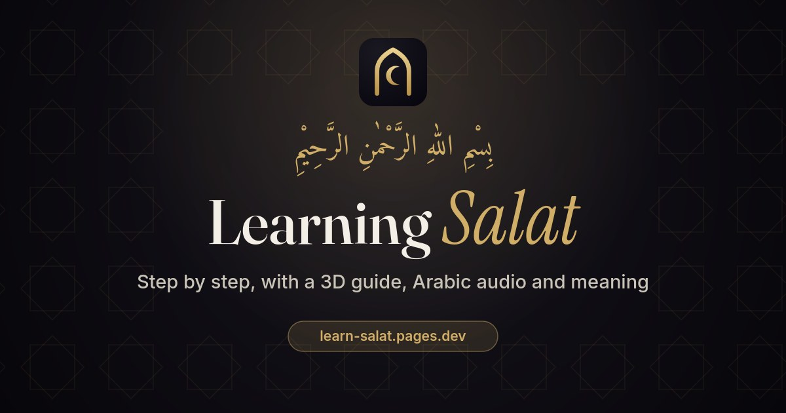

# Learning Salat

An interactive guide that teaches children how to offer **Salat** (the Islamic prayer) step by step. A 3D child shows each posture on a prayer mat while the Arabic is recited, with the transliteration and English translation highlighted phrase by phrase.

**Live:** https://learn-salat.pages.dev



## Features

- **3D guide** for every posture: Takbir-i-Tahrimah, Qiyam, Ruku‘, Qaumah, Sajdah, Jilsah, Qa‘dah with Tashahhud, and Salam. Front, side and back views.
- **Arabic audio** for every recitation. Multi-phrase recitations highlight each phrase in Arabic, transliteration and translation as it is recited.
- **Show or hide** the Arabic, transliteration and translation.
- **1, 2, 3 or 4 rak‘at** (1 for learning; Fajr; Maghrib; Zuhr, ‘Asr and ‘Isha’), one step at a time or **Play all**.
- **Settings:** audio speed (0.75× to 1.75×, default 1.25×) and text size, remembered on the device.
- **Stars** as rewards and a short **quiz**.
- Day and night lighting, works on phones and desktops, no install or sign-in.

## Sources

- **Method, postures, Arabic, transliteration and translations:** [Salat – The Muslim Prayer Book](https://www.alislam.org/book/salat/method-of-offering-prayer/), alislam.org.
- **Recitations:** [Online Salat Guide](https://www.alislam.org/articles/online-salat-guide/), alislam.org. The recordings are not included in this repository (see *Audio* below).
- **Qur’anic Arabic text:** [Al Quran Cloud](https://alquran.cloud/) (Uthmani script).
- **3D character:** [MakeHuman / MPFB](https://static.makehumancommunity.org/mpfb.html) (CC0 assets), dressed and rigged in [Blender](https://www.blender.org/).
- **Rendering:** [three.js](https://threejs.org/) (MIT). **Fonts:** Fraunces, Inter, Instrument Serif and Amiri from Google Fonts (SIL OFL).

This is an independent learning project and is not an official alislam.org product.

## Project layout

```
index.html              the app (single page)
css/app.css             styles (dark and light themes)
js/
  main.js               steps, playback, settings, quiz
  content.js            recitations (Arabic, transliteration, translation) and the step list
  scene.js              three.js scene: room, mat, lighting, camera, pose player
  poses.js              postures and the in-between motions
  child.js              loads the rigged child; arms, fingers, eyes and blinking
  audio.js              recitation playback with phrase timing
models/                 child.glb and the baked prayer hall (room.glb, lightmaps, probes)
audio/clips.json        phrase timings for each recitation (the .mp3 files are not included)
icons/, og-image.jpg    favicon, app icons and link preview
dev/                    inspection helpers used during development (not deployed)
tools/
  blender/              builds the child (child_base.py, child_full.py) and the room (room.py)
  audio/                cuts and levels the recitations, and helps find phrase timings
  textures/             wall plaster texture
  serve.py              local no-cache server
```

## Run locally

It is a static site with no build step.

```sh
python3 tools/serve.py .        # http://127.0.0.1:8765
```

### Audio

The recitations come from the alislam.org Online Salat Guide and are not redistributed here. To build them, download the guide's recordings into a folder, then run:

```sh
python3 tools/audio/build_audio.py <guide-mp3-folder> audio/
```

This needs `ffmpeg` and `numpy`. It writes one `.mp3` per recitation and `audio/clips.json` with the phrase timings.

## Rebuilding the 3D assets

Requires Blender 5.2 with the MPFB extension and its asset packs.

```sh
# The child: base human, then clothing, hair, eyes, rig additions and glTF export
blender -b --python tools/blender/child_base.py -- child_base.blend
blender -b tools/blender/child_base.blend --python tools/blender/child_full.py -- out/child.blend models/child.glb out/tex

# The prayer hall: geometry, Cycles light bake (day and night) and export
blender -b --python tools/blender/room.py -- out/room 256
```

`MPFB_USER_DATA` and `MPFB_DATA` can point the child build at non-default MPFB folders.

## Deploy

The live site is hosted on Cloudflare Pages. Deploy a clean copy of the site (without `dev/`, `tools/` and local files):

```sh
rsync -a --exclude dev --exclude tools --exclude '.*' --exclude '*.md' ./ /tmp/salat-dist/
npx wrangler@4.40.0 pages deploy /tmp/salat-dist --project-name learn-salat --branch main
```
